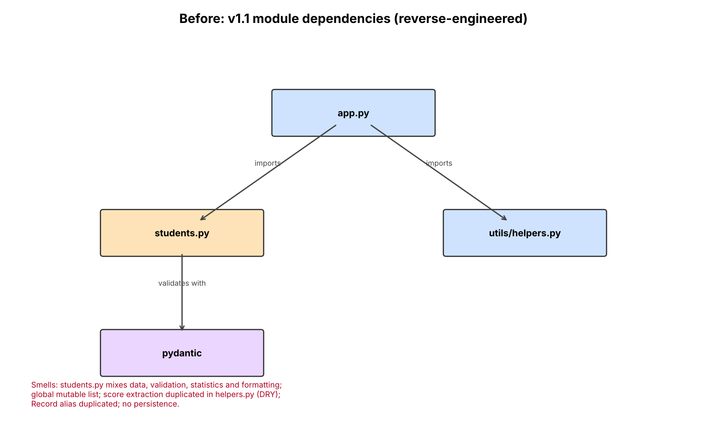
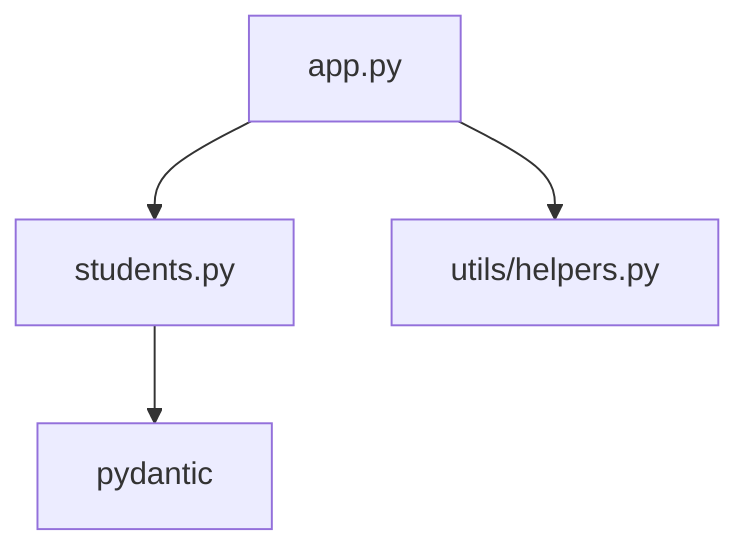
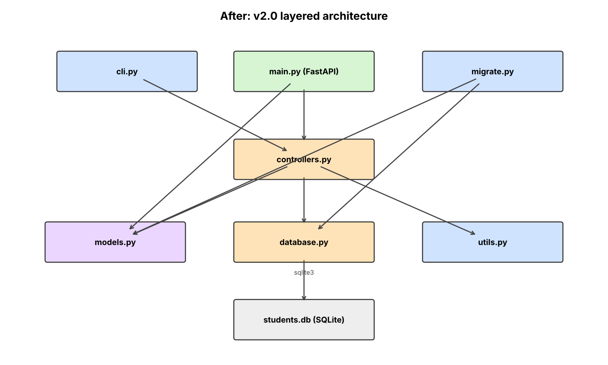
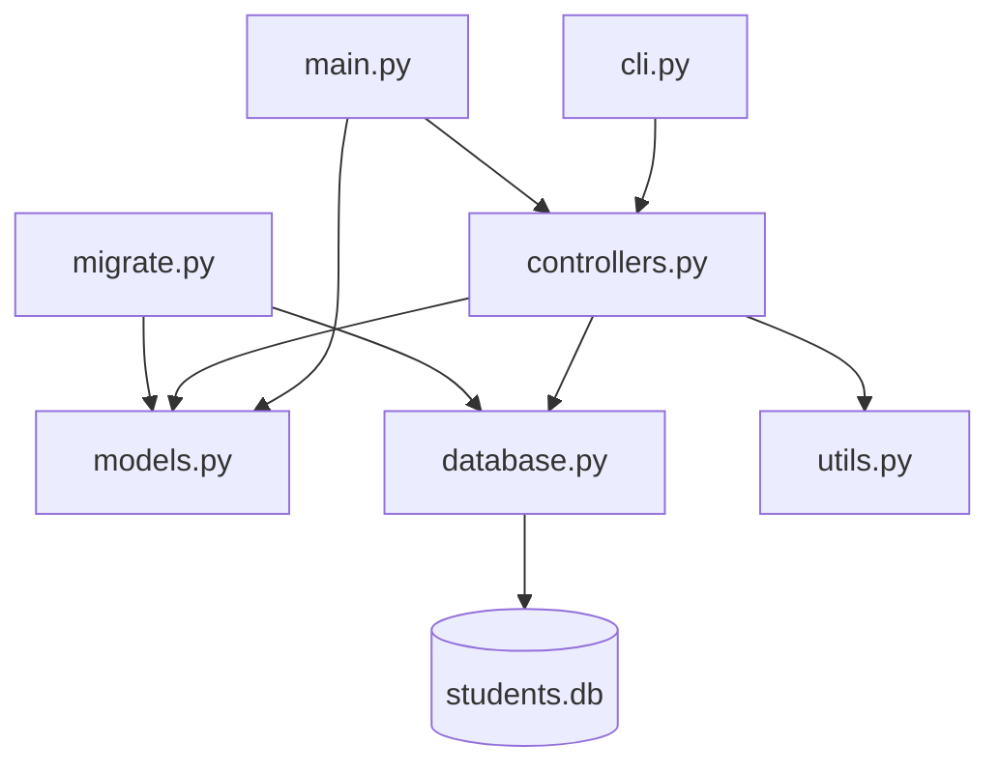

# Reverse Engineering Notes (v1.1 -> v2.0)

## Inventory of the v1.1 code
| Module | Functions / classes |
|---|---|
| `app.py` | `main()` |
| `students.py` | `Student` (Pydantic model), `strip_name()`, `add_student()`, `average_score()`, `median_score()`, `format_table()`, `_scores()` |
| `utils/helpers.py` | `highest_score()`, `lowest_score()` |

## Dependency diagram (before)

## Problems found (coupling / code smells)
1. **Low cohesion**: `students.py` holds data, validation, statistics and console formatting.
2. **Global mutable state**: the module level `students` list is shared by every caller.
3. **DRY violation**: score extraction (`float(d["score"])`) exists in `students.py` and `helpers.py`; the `Record` alias is declared twice.
4. **No persistence**: data is hard coded in the module and lost on exit.
5. **No service interface**: the only entry point is a console script.

## Target design (after)

| Layer | Module | Responsibility |
|---|---|---|
| Presentation | `cli.py`, `main.py` | console report, REST API |
| Application | `controllers.py` | use cases (add / list / get / delete / stats) |
| Domain | `models.py`, `utils.py` | validated models, pure statistics + formatting |
| Infrastructure | `database.py`, `migrate.py` | SQLite access, JSON -> SQLite migration |
